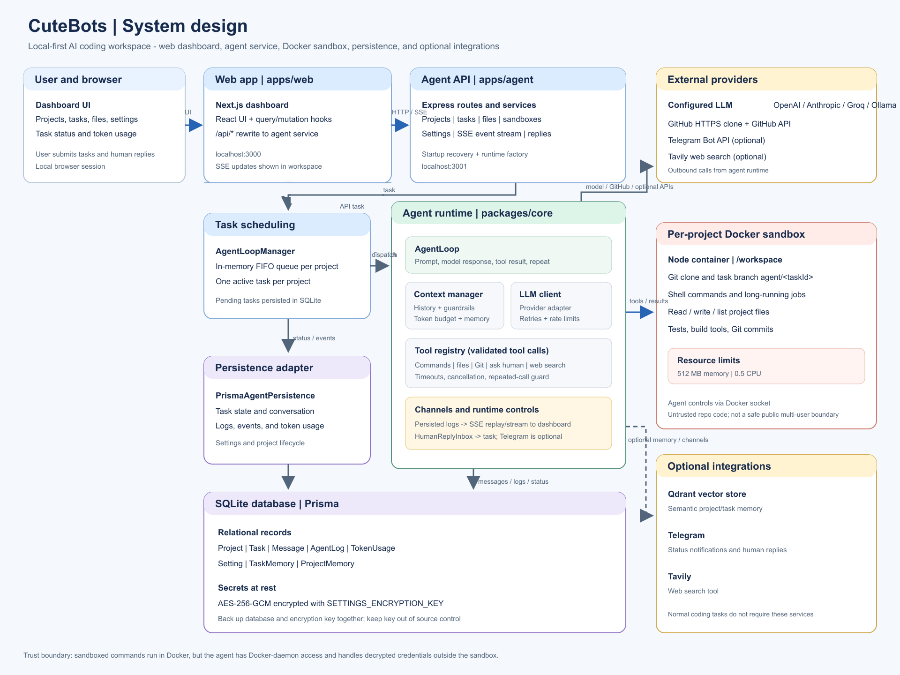

# CuteBots

CuteBots is a local AI coding workspace for creating projects, running coding tasks in isolated Docker sandboxes, and following agent progress from a browser dashboard. It combines a Next.js web app with a persistent agent service, SQLite storage, and optional Telegram notifications and human-in-the-loop replies.

The agent can work against GitHub repositories, make changes in a per-project sandbox, and report task activity in the dashboard. When Telegram is configured, it can also send task updates and ask for a reply when it needs a decision.

## Project layout

- `apps/web`: Next.js dashboard
- `apps/agent`: API, task queue, agent runtime, and sandbox lifecycle
- `packages/core`: agent loop, tools, channels, and Docker sandbox utilities
- `packages/db`: Prisma schema, migrations, and persistence

## System design



### Components and boundaries

| Component | Responsibility |
| --- | --- |
| Browser dashboard (`apps/web`) | Project, task, sandbox, file, and settings UI. Next.js serves the dashboard and rewrites `/api/*` requests to the agent API. |
| Agent API (`apps/agent`) | Express routes and services for projects, tasks, sandboxes, files, settings, event streams, and human replies. It owns task recovery and runtime construction. |
| Agent runtime (`packages/core`) | A per-project queue runs one task at a time. Each task loop builds context, calls a configured model, executes validated tool calls, persists messages and logs, and applies retry, timeout, cancellation, and iteration limits. |
| Docker sandbox | A per-project Node container holds the cloned repository and executes shell commands and file operations. The agent service controls it through Docker. |
| Persistence (`packages/db`) | Prisma with SQLite stores projects, tasks, messages, logs, token usage, settings, and memory facts. Provider and GitHub credentials are encrypted using `SETTINGS_ENCRYPTION_KEY`. |
| Optional integrations | Telegram provides notifications and human replies; Tavily provides web search; Qdrant backs optional semantic memory. Model requests go to the configured provider (or a local Ollama-compatible endpoint). |

The browser talks to the Next.js app on port `3000`; the app forwards `/api/*` to the agent service on port `3001`. In Docker Compose, the web and agent use the private `app-net` network, while project sandboxes join `sandbox-net`. The agent container mounts the Docker socket to manage those sandboxes.

### Task execution

```mermaid
sequenceDiagram
    actor User
    participant Web as Next.js dashboard
    participant API as Agent API and task service
    participant Queue as Per-project task queue
    participant Loop as Agent loop and tool registry
    participant Model as Configured LLM provider
    participant Sandbox as Project Docker sandbox
    participant DB as SQLite via Prisma

    User->>Web: Create project, then submit task
    Web->>API: POST /api/projects
    API->>DB: Persist project
    API->>Sandbox: Create isolated container
    API->>DB: Save sandbox state
    Web->>API: POST /api/projects/:id/tasks
    API->>DB: Persist pending task
    API->>Queue: Enqueue task
    Queue->>Loop: Run when project slot is available
    Loop->>DB: Load conversation history
    Loop->>Sandbox: Clone repo on agent/<taskId> (first task)
    loop Until completion, failure, cancellation, or limit
        Loop->>Model: Context, instructions, tools
        Model-->>Loop: Text response or tool calls
        Loop->>DB: Persist assistant message, usage, and events
        opt Tool call
            Loop->>Sandbox: Read/write files or run/poll/cancel command
            Sandbox-->>Loop: Tool result
            Loop->>DB: Persist tool result and event
        end
        opt Ask human
            Loop-->>Web: Stream question over SSE
            User->>API: Submit reply
            API-->>Loop: Deliver reply to waiting task
        end
    end
    Loop->>DB: Persist final task status
    API->>DB: Read persisted events
    API-->>Web: Replay/stream events over SSE
```

### Repository, credentials, and events

- On the first task, the runtime clones the configured GitHub repository into the sandbox and creates a task branch. Public repositories need no clone credential; private repositories use the separately stored read-only clone credential.
- File edits, shell commands, tests, and Git commits happen in the sandbox. For a push, the sandbox exports a branch bundle to the agent service, which performs the authenticated push using the encrypted write token. The token is not passed into the sandbox. Pull-request creation uses the GitHub API.
- Agent events are persisted before they are streamed. SSE clients can replay missed events from their last received event ID. Human replies are delivered through the in-process reply inbox; Telegram can provide an additional reply channel.
- Optional semantic memory stores/searches task and project facts through Qdrant. Without the required memory and embedding configuration, normal task execution does not depend on it.

### Operational and trust boundaries

CuteBots is intended for one trusted local user. In Docker Compose, only the web and agent ports are published to localhost. The agent has access to the Docker daemon, which is highly privileged; sandboxing reduces exposure from repository commands but is not a security boundary for an internet-facing multi-user service. Keep the dashboard, API, and Docker socket inaccessible to untrusted users, and review generated changes before merging.

## Get started

See [tutorial.md](./tutorial.md) for setup, Groq configuration, GitHub credentials, Telegram bot setup, running with or without Docker, and day-to-day usage.

CuteBots is designed for one trusted local user. The agent controls the host Docker daemon, and sandbox code should be treated as untrusted. Keep the dashboard and agent bound to localhost and do not expose the Docker socket or services to untrusted users.
